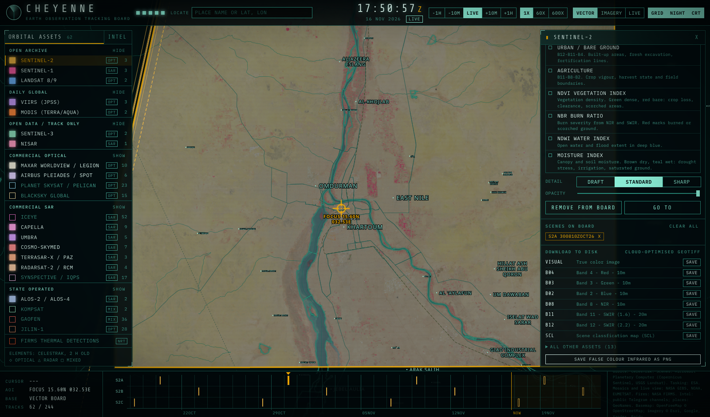
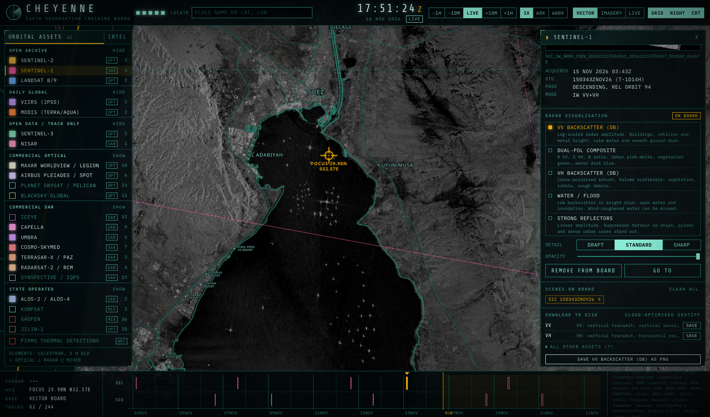

# Cheyenne

An earth-observation tracking board for open-source investigators of conflict, humanitarian
crises and natural disasters. An interactive globe shows where imaging satellites are right now,
what they have already imaged over a place, and what they are scheduled to image next. Free
imagery can be drawn on the globe or saved to disk, and live fire detections, weather imagery and
Telegram reports can be laid over the same map.


It runs on your own machine: a small Python server and a browser tab. There is nothing to build,
and the core features need no accounts or API keys.

## Contents

- [Features](#features)
- [Installation](#installation)
- [Using the board](#using-the-board)
- [Intel: Telegram monitor](#intel-telegram-monitor)
- [Data sources](#data-sources)
- [Limitations](#limitations)
- [Project layout](#project-layout)
- [Credits and licences](#credits-and-licences)

## Features

- **Live satellite tracking.** Real-time positions, ground tracks and sensor swaths for 23 fleets
  of imaging satellites: open missions (Sentinel-1, Sentinel-2, Landsat), daily global sensors
  (VIIRS, MODIS), commercial optical and radar operators, and state-run systems. The clock can be
  jumped or accelerated to see where satellites will be.
- **Archive search.** For Sentinel-2, Sentinel-1 and Landsat 8/9, footprints of every scene taken
  over a place in a chosen period, on the globe and on a timeline.
- **Future passes.** ESA's published acquisition plans for Sentinel-1 and Sentinel-2, and
  predicted passes for every other fleet, computed from current orbits and sensor geometry.
- **Imagery on the globe.** Any open scene can be rendered in place. Only small tiles inside the
  scene are fetched, so the board stays responsive.
- **Visualisations by sensor type.** Optical: true colour, false-colour infrared, shortwave
  infrared, burn ratio, vegetation, water and moisture indices. Radar: backscatter,
  dual-polarisation composite, water and flood, strong reflectors. Landsat adds thermal.
- **Downloads.** Individual bands as cloud-optimised GeoTIFF, or the current rendering as a PNG.
- **Fire detections.** NASA FIRMS near-real-time thermal detections for the last 24 hours,
  48 hours or 7 days.
- **Live weather view.** The newest full-disc imagery from the geostationary weather satellites,
  draped on the globe and refreshed every five minutes.
- **Basemaps.** A vector board, or the Esri World Imagery satellite mosaic.
- **Intel.** Follows public Telegram channels, places each post on the map with an icon for the
  kind of event, and raises an alert when a new located report arrives.
- **Shareable views.** The address bar records the view, fleet, focus point and time window.

| | |
| --- | --- |
|  Optical: a Sentinel-2 scene in false-colour infrared |  Radar: ships at anchor off Suez in a Sentinel-1 scene |
|  FIRMS thermal detections, last 24 hours |  Live view from the geostationary weather satellites |

## Installation

### Requirements

- Python 3.9 or newer (3.10 or newer for the optional Intel place extraction)
- A current desktop browser with WebGL (Chrome, Edge, Firefox or Safari)
- An internet connection, for orbital elements, map tiles and imagery

### Get the code and run it

```sh
git clone https://github.com/<your-username>/cheyenne.git
cd cheyenne
./run.sh
```

Then open <http://localhost:8642/>. On Windows, run `python server.py` instead of `./run.sh`.

Options:

| Option | Default | Meaning |
| --- | --- | --- |
| `--port` | `8642` | Port to serve on |
| `--host` | `127.0.0.1` | Interface to bind. `0.0.0.0` exposes the board to your network |
| `--intel-budget` | `0.65` | Default daily spending cap, in US dollars, for Intel place extraction |

### Optional: place extraction for the Intel tab

Everything except one step works with Python alone. The Intel tab uses a small Claude model
(`claude-haiku-5-5`) to work out where each Telegram post is about, which needs Anthropic's
Python library and an Anthropic API login:

```sh
python3 -m venv .venv
.venv/bin/pip install -r requirements-intel.txt
ant auth login          # Anthropic's command-line tool; or set ANTHROPIC_API_KEY instead
```

`./run.sh` uses `.venv` automatically when it exists. If you start the server another way, use
`.venv/bin/python server.py`. Without this step the Intel tab still lists posts, but only those
containing written coordinates are placed on the map.

## Using the board

1. **Pick a fleet.** The left panel lists every tracked fleet. The coloured lamp shows or hides a
   fleet on the globe. Clicking the name selects it: its ground tracks and sensor swaths are
   drawn and the mission panel opens on the right.
2. **Choose an area.** A scan covers the current view once you have zoomed in, or a fixed focus
   point. Set one with `DESIGNATE` and a click on the globe, or type a place name or `lat, lon`
   into `LOCATE`.
3. **Scan.** For Sentinel-2, Sentinel-1 and Landsat 8/9 the scan lists scenes already acquired in
   the lookback window (or an explicit date range) under `ACQUIRED`, and upcoming passes under
   `TASKING`. Footprints appear on the globe and on the timeline along the bottom.
4. **Open a footprint.** Click one on the globe, in the list or on the timeline. From there you
   can pick a visualisation, `RENDER ON BOARD`, save bands as GeoTIFF, or save the rendering as a
   PNG. Up to six scenes stay on the board at once.
5. **Move the clock.** The board runs in real time. The buttons in the top bar jump or accelerate
   it, and `RUN CLOCK TO PASS` on an upcoming pass moves the board to that moment.

Other controls:

- **Basemap.** `VECTOR`, `IMAGERY` and `LIVE` switch the basemap. `IMAGERY` is the Esri World
  Imagery mosaic. `LIVE` offers three products, chosen with the picker beside it: `GEOCOLOUR`
  (true colour by day, infrared at night), `NATURAL` and `INFRARED`.
- **Fires.** The `FIRMS THERMAL DETECTIONS` lamp under the fleet list switches the overlay on.
  Hover a detection for its details; click it to designate it as the focus and scan for imagery.
- **Display.** `GRID`, `NIGHT` and `CRT` toggle the graticule, the day/night terminator and the
  scanline effect.

### What the future footprints mean

| Label | Source | Reliability |
| --- | --- | --- |
| `PLANNED` | ESA acquisition plans for Sentinel-1 and Sentinel-2 | The operator's published schedule. Revised without notice. |
| `PREDICTED` (Landsat and other fixed-swath sensors) | Computed from current orbital elements and swath width | Good for about a week; Landsat images all daylit land. |
| `PREDICTED` (commercial, steerable sensors) | Same computation, using the sensor's pointing range | Opportunity only. Whether the operator is tasking the area is not public. |

## Intel: Telegram monitor


The `INTEL` tab in the left panel follows a list of public Telegram channels. While it is
switched on, the server reads each channel once a minute, keeps the last 24 hours of posts, and
places each post on the globe where it can be located. A new located report raises an alert card,
a pulsing ring on the globe and, optionally, a tone.

- **Feed.** Newest first. Filter by channel or group, placed or unplaced, and category (the row
  of icons). Click a row to fly to the report.
- **A report.** Shows an English summary, the source post, where it was placed and how precisely.
  `DESIGNATE FOCUS` searches imagery of that place with the selected fleet, `FIRMS` checks for
  thermal detections nearby, and `CLOCK TO` moves the board clock to the time of the post.
- **Channels.** Add a channel by `@username` or `t.me` link, pause it with its lamp, or remove
  it. Twenty channels covering the war in Ukraine and the Middle East are followed to start with.
  They include official, partisan and state-run sources from several sides.

**Reports are unverified.** The map shows where a post says something happened, as read by a
language model. It is not a confirmed event location. A dashed ring means the report could only
be placed to a district or region, or that the place was not in the gazetteer and the position is
the model's estimate.

How a post is placed:

1. Coordinates written in the post are used as they are.
2. Otherwise the model names the place where the event happened, the kind of event, and a
   one-line English summary.
3. The place name is looked up in an offline GeoNames gazetteer. The model's own rough
   coordinates are only used to choose between places that share a name.

Cost, limits and privacy:

- **Cost.** The starting 20 channels produce about 1,100 posts a day, which costs roughly $0.10
  a day to analyse. Extraction stops for the day at the daily budget (default $0.65; change it in
  the Channels view or with `--intel-budget`). The tab shows the estimated spend.
- **Only while watched.** Nothing is fetched or spent unless a browser has the monitor switched
  on. Three minutes after the last browser closes, the server stops; it catches up on reopening.
- **Public channels only.** The reader uses Telegram's public web preview
  (`t.me/s/<channel>`), which is not an official API. Private channels and channels with the
  preview turned off cannot be followed, and the reader will need fixing if Telegram changes the
  page.
- **What leaves your machine.** Telegram sees your IP address requesting each channel page; no
  account is involved. Post text and channel names are sent to Anthropic for analysis. Thumbnails
  load from Telegram's servers when you open a report, and stay blurred until clicked.
- **Storage.** Your channel list and seven days of posts are kept in `data/intel.db`. The
  gazetteer (about 130 MB) is downloaded once into `.cache/gazetteer`.

## Data sources

| Data | Source |
| --- | --- |
| Orbital elements | CelesTrak GP data, cached on disk for 3 hours |
| Acquired scenes, tiles, downloads | Microsoft Planetary Computer (Sentinel-2 L2A, Sentinel-1 GRD, Landsat C2 L2) |
| Tasking plans | ESA Sentinel acquisition plan KML files |
| Daily global mosaics | NASA GIBS (MODIS, VIIRS) |
| Fire detections | NASA FIRMS near-real-time files (VIIRS on NOAA-20/21, MODIS on Terra/Aqua), cached for 20 minutes |
| Live view | GOES-East/West GeoColor via NASA GIBS; Meteosat and geostationary-ring mosaics via EUMETSAT EUMETView |
| Vector basemap | OpenFreeMap (OpenMapTiles schema, OpenStreetMap data) |
| Imagery basemap | Esri World Imagery |
| Place search | OpenStreetMap Nominatim |
| Intel posts | Public Telegram channel previews (`t.me/s/<channel>`) |
| Intel place names | GeoNames (CC BY 4.0): every place in 20 countries around the two conflicts, towns over 500 people elsewhere |
| Intel place extraction | Anthropic API, `claude-haiku-5-5` (optional; needs a login or API key) |

No accounts or API keys are needed for any of these except Intel place extraction.

## Limitations

- **Predicted passes** for commercial satellites show when a satellite could image a place, not
  whether it will.
- **Live view.** `GEOCOLOUR` has colour imagery over the Americas, Atlantic, Europe and Africa;
  Asia and the western Pacific show infrared. The whole-globe mosaics update every 3 hours.
- **The 7-day FIRMS window** downloads about 60 MB on first use and shows the 150,000 strongest
  detections in view; zoom in to see them all.
- **Downloads are large.** A Sentinel-1 polarisation is roughly 600 MB to 1 GB.
- **Local use.** The server has no user accounts or access control. It binds to `127.0.0.1` by
  default; do not expose it to the internet.

## Project layout

```
server.py              Local server: static files plus /api (TLE cache, plan parser, FIRMS cache, download proxy)
intel.py               Intel: Telegram reader, post database, gazetteer, place extraction
run.sh                 Starts the server, using .venv when present
requirements-intel.txt Optional dependency for Intel place extraction
web/catalog.json       Fleets: name patterns, sensor geometry, archive collection, colours
web/js/                Front end as plain ES modules (no bundler)
  main.js                boot and wiring
  globe.js               map, board layers, imagery layers      basemap.js   vector style
  tracker.js             SGP4 propagation, tracks, pass prediction
  archive.js             scene search, plans, access prediction  viz.js       rendering presets
  mission.js             right-hand panel and scan controller    ui.js        top bar, roster, pointer
  board.js               per-frame plotting                      timeline.js  bottom timeline
  firms.js               fire-detection overlay                  live.js      geostationary live view
  intel.js               Intel tab, report markers, cards and alerts
web/vendor/            MapLibre GL JS 5, satellite.js 5, fonts and their licences (no CDN at runtime)
docs/screenshots/      Images used in this README
```

Created at runtime and ignored by git:

```
.cache/                Downloaded elements, plans, fire files and the gazetteer (safe to delete)
data/                  Intel channel list and stored posts
.venv/                 Optional Python environment for Intel place extraction
```

Extending it:

- **Add an imagery basemap.** Add an entry to `IMAGERY` in `web/js/basemap.js` for any Web
  Mercator tile source you are licensed to use. A source picker appears once there are two.
- **Add a fleet.** Add an entry to `web/catalog.json`; `match` is a list of regular expressions
  tested against CelesTrak object names.
- **Change the starting channels.** Edit `DEFAULT_CHANNELS` in `intel.py`. They are only used to
  seed a new `data/intel.db`.
- **Extend the Intel gazetteer to another region.** Add its country codes to `GAZ_COUNTRIES` in
  `intel.py`, raise `GAZ_VERSION`, and restart; the gazetteer rebuilds on next use.

## Credits and licences

Cheyenne bundles these third-party components; their licence texts are in
[`web/vendor/licenses/`](web/vendor/licenses/):

| Component | Licence |
| --- | --- |
| [MapLibre GL JS](https://github.com/maplibre/maplibre-gl-js) 5.24.1 | BSD 3-Clause |
| [satellite.js](https://github.com/shashwatak/satellite-js) 5.0.0 | MIT |
| IBM Plex Mono | SIL Open Font License 1.1 |
| Share Tech Mono | SIL Open Font License 1.1 |

Data is provided by CelesTrak, ESA and the Copernicus programme, USGS, the Microsoft Planetary
Computer, NASA (GIBS and FIRMS), NOAA, EUMETSAT, OpenFreeMap and OpenStreetMap contributors,
Esri, and GeoNames. Each provider's own terms apply to its data.
