# Cheyenne

An earth-observation tracking board for open-source investigators of conflict, humanitarian
crises and natural disasters. An interactive globe shows where imaging satellites are right now,
what they have already imaged over a place, and what they are scheduled to image next. Free
imagery, from Sentinel and Landsat to the sub-metre disaster releases of Vantor and Planet, can be
drawn on the globe, turned into a time-lapse or saved to disk, and live fire detections, ship
positions, weather imagery and Telegram reports can be laid over the same map. Any report on the
map, or any pair of images, can be turned into a card ready to post on social media.

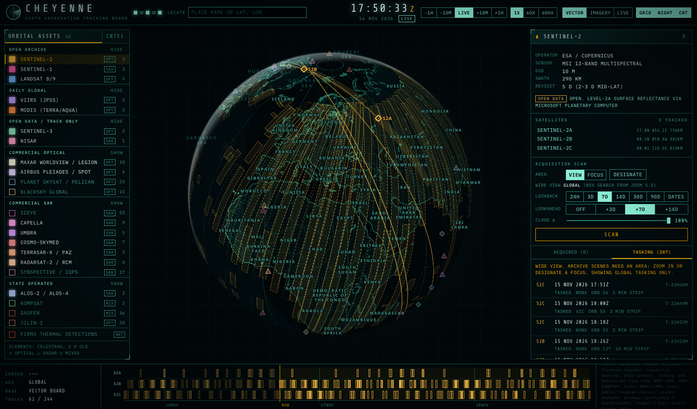

It runs on your own machine: a small Python server and a browser tab. There is nothing to build,
and the core features need no accounts or API keys.

## Contents

- [Features](#features)
- [Installation](#installation)
- [Using the board](#using-the-board)
- [AIS: ship tracking](#ais-ship-tracking)
- [Intel: Telegram monitor](#intel-telegram-monitor)
- [Data sources](#data-sources)
- [Limitations](#limitations)
- [Project layout](#project-layout)
- [Credits and licences](#credits-and-licences)

## Features

- **Live satellite tracking.** Real-time positions, ground tracks and sensor swaths for 23 fleets
  of imaging satellites: open missions (Sentinel-1, Sentinel-2, Landsat), daily global sensors
  (VIIRS, MODIS), commercial optical and radar operators, and state-run systems. The clock can be
  jumped or accelerated to see where satellites will be.
- **Archive search.** For Sentinel-2, Sentinel-1, Landsat 8/9 and NISAR, footprints of every scene
  taken over a place in a chosen period, on the globe and on a timeline.
- **Free very-high-resolution releases.** The 30 to 80 cm imagery that Vantor (formerly Maxar) and
  Planet release free for major disasters, from 2017 onwards, listed by event and drawn on the globe
  at full resolution.
- **Time-lapse GIFs.** An animated GIF of one place through every Sentinel-2, Sentinel-1, Landsat
  or NISAR scene in the search window, one frame per date, stamped with date, sensor and credit.
- **Share cards.** PNG images for social media in the board's own style: an Intel report on the
  map with whatever imagery, fire detections and ships are drawn there, or a before / after pair
  of scenes (from any fleets) with their dates and sensors. Three sizes, with suggested post text.
- **Future passes.** ESA's published acquisition plans for Sentinel-1 and Sentinel-2, and
  predicted passes for every other fleet, computed from current orbits and sensor geometry.
- **Imagery on the globe.** Any open scene can be rendered in place. Only small tiles inside the
  scene are fetched, so the board stays responsive.
- **Visualisations by sensor type.** Optical: true colour, false-colour infrared, shortwave
  infrared, burn ratio, vegetation, water and moisture indices. Radar: backscatter,
  dual-polarisation composite, water and flood, strong reflectors. Landsat adds thermal.
- **Downloads.** Individual bands as cloud-optimised GeoTIFF, or the current rendering as a PNG.
- **Fire detections.** NASA FIRMS near-real-time thermal detections for the last 24 hours,
  48 hours or 7 days.
- **Ship tracking.** Live AIS positions merged from four free feeds (aisstream.io, Fintraffic,
  Open Waters and Pelyr), coloured by ship type, with each ship's details and recent track, and a
  map of where free AIS coverage actually exists.
- **Live weather view.** The newest full-disc imagery from the geostationary weather satellites,
  draped on the globe and refreshed every five minutes.
- **Basemaps.** A vector board, or the Esri World Imagery satellite mosaic.
- **Intel.** Follows public Telegram channels, places each post on the map with an icon for the
  kind of event, and raises an alert when a new located report arrives. Ten ready-made groups of
  ten channels cover the main regions of conflict and crisis, plus cyber security.
- **Shareable views.** The address bar records the view, fleet, focus point and time window.

| | |
| --- | --- |
|  Optical: a Sentinel-2 scene in false-colour infrared |  Radar: ships at anchor off Suez in a Sentinel-1 scene |
| 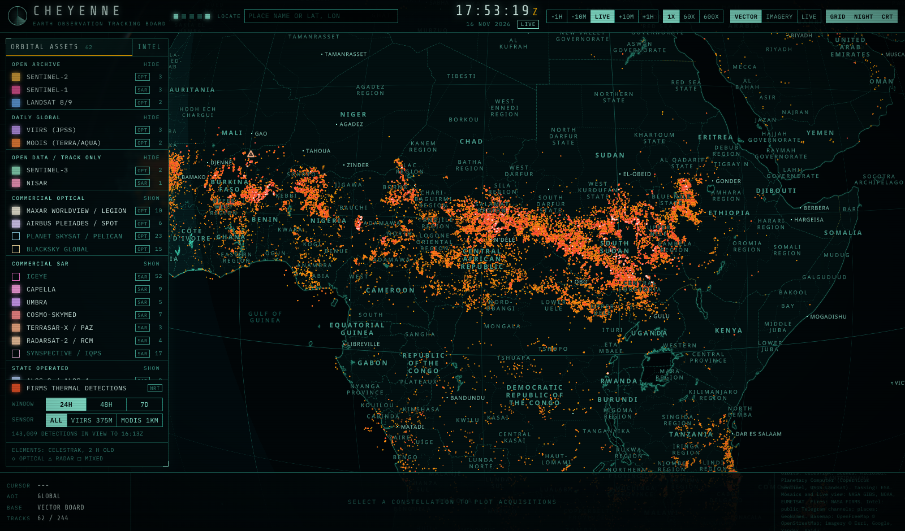 FIRMS thermal detections, last 24 hours | 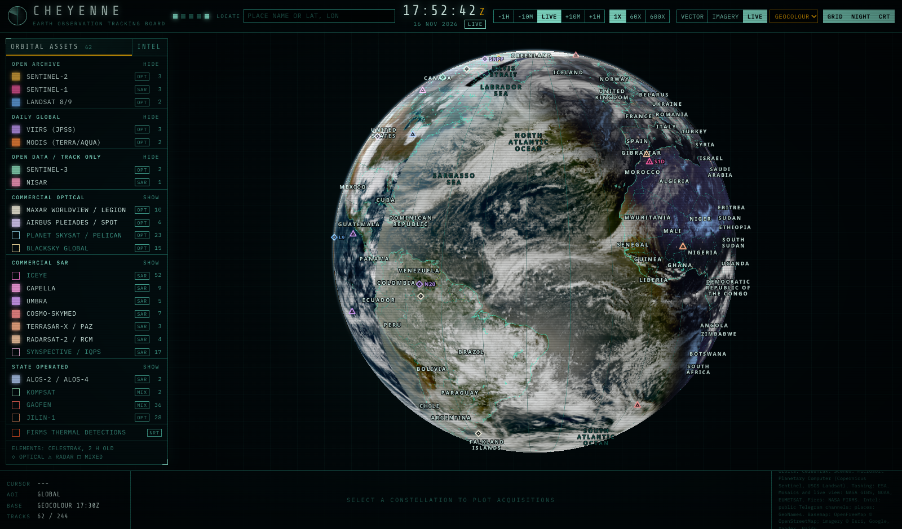 Live view from the geostationary weather satellites |
| 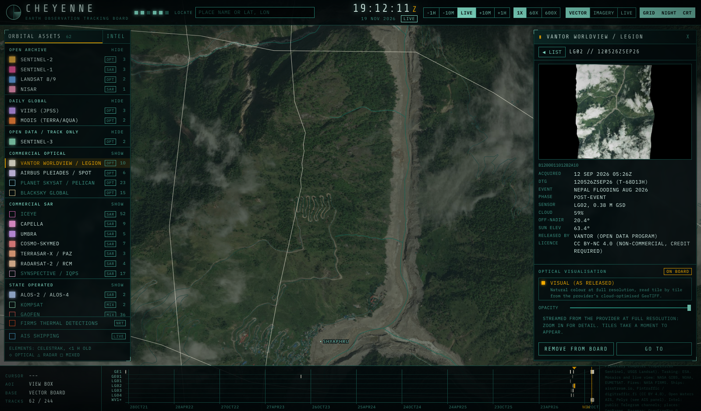 Free releases: a 38 cm Vantor image after the 2026 Nepal flood | 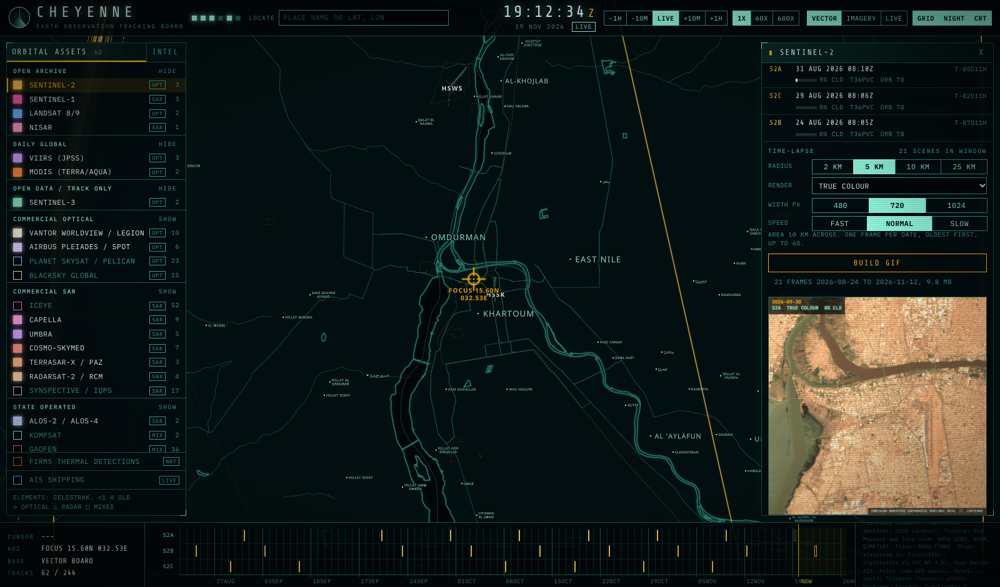 Time-lapse: 21 Sentinel-2 dates over Khartoum |

## Installation

### Requirements

- Python 3.9 or newer (3.10 or newer for the optional extras)
- A current desktop browser with WebGL (Chrome, Edge, Firefox or Safari)
- An internet connection, for orbital elements, map tiles and imagery

### Get the code and run it

```sh
git clone https://github.com/MJCruickshank/cheyenne.git
cd cheyenne
./run.sh
```

Then open <http://localhost:8642/>. On Windows, run `python server.py` instead of `./run.sh`
(or `.venv\Scripts\python server.py` once you have installed the optional extras).

Options:

| Option | Default | Meaning |
| --- | --- | --- |
| `--port` | `8642` | Port to serve on |
| `--host` | `127.0.0.1` | Interface to bind. `0.0.0.0` exposes the board to your network |
| `--intel-budget` | `0.65` | Default daily spending cap, in US dollars, for Intel place extraction |

### Optional extras

The core board works with Python alone. Two features need a Python package and a free account:

| Feature | Package | Account |
| --- | --- | --- |
| AIS ship tracking | `websockets` (every feed except Fintraffic, which works without it) | None for Fintraffic and Open Waters. Optional free keys for the other feeds (below) |
| Intel place extraction | `anthropic` | An Anthropic API login (`ant auth login`) or `ANTHROPIC_API_KEY` |

AIS keys, all optional, read from environment variables when the server starts:

| Variable | Feed | How to get it |
| --- | --- | --- |
| `AISSTREAM_API_KEY` | aisstream.io, the only whole-globe feed | Sign in at [aisstream.io](https://aisstream.io) with GitHub and create a key |
| `OPENWATERS_TOKEN` | Open Waters (raises its limits; works without) | [openwaters.io/ais/token](https://openwaters.io/ais/token/), free, no account |
| `PELYR_API_KEY` | Pelyr | Sign in at [dashboard.pelyr.com](https://dashboard.pelyr.com/stream); the key needs the `stream` capability |

Install both packages into a project environment:

```sh
python3 -m venv .venv
.venv/bin/pip install -r requirements.txt
```

`./run.sh` uses `.venv` automatically when it exists. If you start the server another way, use
`.venv/bin/python server.py`.

To store a key on macOS or Linux (zsh shown; use `~/.bashrc` for bash), run this, paste the key
when asked, then open a new terminal. Change the variable name for the other keys:

```sh
read -s "KEY?Paste key: " && echo "export AISSTREAM_API_KEY='$KEY'" >> ~/.zshrc && unset KEY
```

The server reads keys when it starts, so start it from a terminal that has them set.
Without the Anthropic login, the Intel tab still lists posts, but only those containing written
coordinates are placed on the map.

## Using the board

1. **Pick a fleet.** The left panel lists every tracked fleet. The coloured lamp shows or hides a
   fleet on the globe. Clicking the name selects it: its ground tracks and sensor swaths are
   drawn and the mission panel opens on the right.
2. **Choose an area.** A scan covers the current view once you have zoomed in, or a fixed focus
   point. Set one with `DESIGNATE` and a click on the globe, or type a place name or `lat, lon`
   into `LOCATE`.
3. **Scan.** For Sentinel-2, Sentinel-1, Landsat 8/9 and NISAR the scan lists scenes already
   acquired in the lookback window (or an explicit date range) under `ACQUIRED`, and upcoming passes
   under `TASKING`. For the Vantor and Planet fleets, `ACQUIRED` lists their free releases from all
   dates. Footprints appear on the globe and on the timeline along the bottom.
4. **Open a footprint.** Click one on the globe, in the list or on the timeline. From there you
   can pick a visualisation, `RENDER ON BOARD`, save bands as GeoTIFF, or save the rendering as a
   PNG. Up to six scenes stay on the board at once.
5. **Move the clock.** The board runs in real time. The buttons in the top bar jump or accelerate
   it, and `RUN CLOCK TO PASS` on an upcoming pass moves the board to that moment.
6. **Make a time-lapse.** After a Sentinel-2, Sentinel-1, Landsat or NISAR scan, the `TIME-LAPSE`
   section under the results builds a GIF of the focus point (2 to 25 km around it) or of the
   scanned view (up to 160 km across). Choose the visualisation, width and speed; for the radars
   (Sentinel-1 and NISAR), choose ascending or descending passes so the viewing geometry stays the
   same. Use the lookback and cloud limit to choose which scenes go in. Frames are reprojected to
   the same grid, so every frame lines up; dates that barely cover the area are left out. `SAVE GIF`
   keeps it. NISAR frames are cut from each product's browse image (about 120 m per pixel, about
   4 MB to fetch each), so a 10 km or wider radius works best, and brightness varies between dates
   because each browse image is contrast-stretched on its own.
7. **Make a share card.** `SHARE CARD` on an Intel report, or the `BEFORE / AFTER` section under
   the scan results, makes a PNG for social media. See [Share cards](#share-cards).

Other controls:

- **Basemap.** `VECTOR`, `IMAGERY` and `LIVE` switch the basemap. `IMAGERY` is the Esri World
  Imagery mosaic. `LIVE` offers three products, chosen with the picker beside it: `GEOCOLOUR`
  (true colour by day, infrared at night), `NATURAL` and `INFRARED`.
- **Fires.** The `FIRMS THERMAL DETECTIONS` lamp under the fleet list switches the overlay on.
  Hover a detection for its details; click it to designate it as the focus and scan for imagery.
- **Display.** `GRID`, `NIGHT` and `CRT` toggle the graticule, the day/night terminator and the
  scanline effect.

### Share cards

| | |
| --- | --- |
| 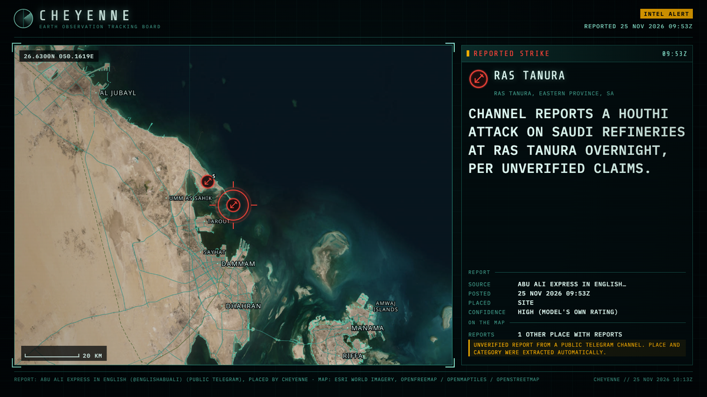 Alert card: an unverified claim from a Telegram channel, on the imagery basemap | 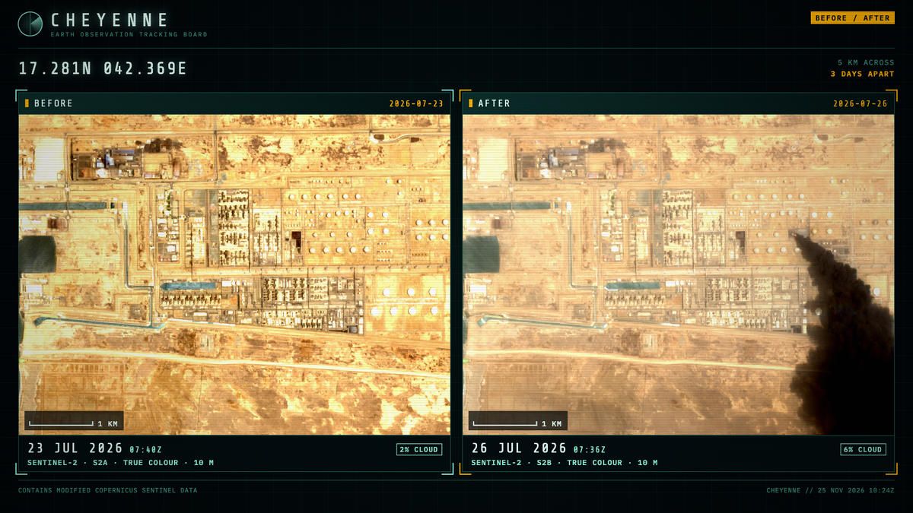 Before / after card: two Sentinel-2 images three days apart |

Cards are PNG images drawn in the board's own style, for posting on social media.

- **Alert card.** `SHARE CARD` on a placed Intel report captures the board around it as it is
  drawn now, so switch on FIRMS or AIS, or render a scene, first to include them. Beside the map go
  the report text, source, time and place, counts of the fire detections, ships and other reports
  in the picture, the scenes shown, and a notice that the report is unverified. `MAP` widens or
  tightens the picture. The board's focus marker, scan outline and footprints are left out.
- **Before / after card.** Two scenes of the same area side by side (stacked in the taller sizes),
  each with its date, time, sensor, visualisation, resolution and cloud cover. The `BEFORE / AFTER`
  section under the scan results picks them: by default the clearest older and newer scenes, or
  the newest pre- and post-event images of a free release. Any scene's detail also has
  `SET AS BEFORE` and `SET AS AFTER`, so the two can come from different fleets, for example
  Sentinel-2 before and Vantor after. Each image is fetched afresh at card resolution over the same
  area, centred on the focus point or the scanned area; `AREA` sets its size. Same-day scenes are
  stitched, and the card always reads in date order.
- **Options.** Three sizes (16:9, 1:1 and 4:5), an optional headline and the scanline effect.
  Each card comes with suggested post text, including the credits. `SAVE PNG`, `COPY IMAGE` and,
  where the browser offers it, `SHARE…` send it on.
- **Credits and licences.** Every card credits its data along the bottom. Cards that include
  Vantor, Maxar or Planet imagery also say that it is licensed for non-commercial use only.

### Free releases and NISAR

- **Vantor WorldView / Legion.** Selecting the fleet lists every disaster with free imagery under
  `RELEASED EVENTS`; click one to fly there. Zoomed in, `ACQUIRED` lists the images over the view:
  the Vantor Open Data Program since late 2025, and the Maxar Open Data Program archive from 2017 to
  2025. Pre-event and post-event images are marked.
- **Planet SkySat / Pelican.** The same for Planet's Crisis Response releases: SkySat and Pelican
  (50 to 80 cm) and PlanetScope (3 to 4 m) scenes, before and after each event.
- **Rendering.** `RENDER ON BOARD` streams the image straight from the provider's cloud-optimised
  GeoTIFF at full resolution: only the parts on screen are downloaded. Zoom in to see the detail.
  Each image can also be saved whole (often 0.5 to 1.5 GB). The imagery is licensed CC BY-NC 4.0:
  non-commercial use only, with credit to Vantor or Planet.
- **NISAR.** The NASA-ISRO L-band radar, listed under `OPEN ARCHIVE`. The scan finds geocoded
  backscatter products (GCOV) from the Alaska Satellite Facility, and `RENDER ON BOARD` drapes each
  product's browse image (about 120 m per pixel, polarisations as colour), or the `TIME-LAPSE`
  section animates them. The full-resolution HDF5 product downloads from the detail panel after a
  free NASA Earthdata login. Products from the provisional release (before October 2026) publish
  their browse georeference only behind that login, so the board positions those browse images
  from the product footprint instead, to within about one browse pixel.
- The first scan of each release catalogue indexes it in the background (about 20 s for Vantor,
  40 s for Planet, 2 to 3 minutes for the Maxar archive). The index is kept in `.cache/opendata` and
  refreshed every six hours (weekly for the archive).

### What the future footprints mean

| Label | Source | Reliability |
| --- | --- | --- |
| `PLANNED` | ESA acquisition plans for Sentinel-1 and Sentinel-2 | The operator's published schedule. Revised without notice. |
| `PREDICTED` (Landsat and other fixed-swath sensors) | Computed from current orbital elements and swath width | Good for about a week; Landsat images all daylit land. |
| `PREDICTED` (commercial, steerable sensors) | Same computation, using the sensor's pointing range | Opportunity only. Whether the operator is tasking the area is not public. |

## AIS: ship tracking

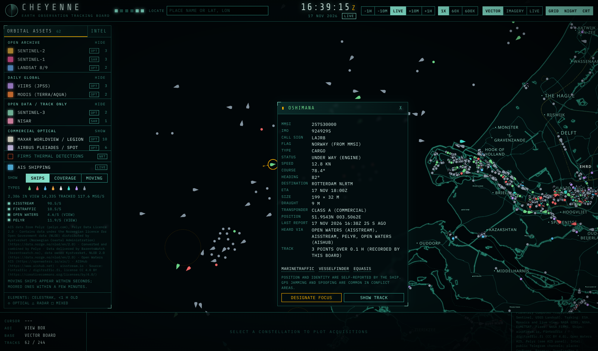

The `AIS SHIPPING` lamp under the fleet list shows ships reporting their position over AIS, the
radio transponder system commercial ships are required to carry. While it is on, the server
merges four free feeds into one picture. A ship heard by several feeds appears once, and an older
report from a slower feed never overwrites a newer one.

| Feed | Area | Key | How it is used |
| --- | --- | --- | --- |
| [aisstream.io](https://aisstream.io) | Whole globe, volunteer shore receivers | `AISSTREAM_API_KEY` | One live connection for the whole globe, about 90 messages a second |
| [Fintraffic Digitraffic](https://www.digitraffic.fi/en/marine-traffic/) | Finnish waters: Gulf of Finland, Archipelago Sea, Gulf of Bothnia | None | Polled once a minute, plus ship details every 10 minutes |
| [Open Waters AIS](https://openwaters.io/ais/) | Strongest in Norway (the official BarentsWatch feed) and the Nordics; also relays Fintraffic, AISHub, aisstream and volunteer stations | None (`OPENWATERS_TOKEN` optional) | Follows the board's view, because it cannot take the whole globe |
| [Pelyr](https://pelyr.com) | Community stations and third-party feeds; no coverage table published | `PELYR_API_KEY` | Follows the board's view, like Open Waters |

The panel lists each feed with its state and message rate, and the credits each feed requires.
Feeds that follow the view cover only part of it when you are zoomed out (100 square degrees for
Open Waters without a token, 400 with one, and 3.5 million km² for Pelyr's free plan), centred on
the middle of the screen. The panel says when that is happening.

- **Ships.** Icons point the way each ship is heading and are coloured by type: cargo, tanker,
  passenger, fishing, military and law enforcement, tug and service, leisure, and other. Ships
  appear as they report: moving ones within seconds, moored ones within a few minutes. Ship types
  and names arrive in a separate message every six minutes, so icons stay grey until then.
  Ships not heard for an hour are dropped.
- **A ship.** Click one for its name, MMSI, IMO, call sign, flag (from the MMSI), type, status,
  speed, destination, size and draught, which feeds heard it, and the track this board has
  recorded over the last six hours. `DESIGNATE FOCUS` searches imagery of the ship's position.
- **Coverage.** `COVERAGE` shades 0.5° cells by how many reports per hour this board has received
  there, from all feeds. It keeps accumulating across sessions in `data/ais-coverage.json`, so it
  becomes more reliable the longer you run it. Places covered only by a view-following feed show up
  once you have looked at them.
- **Filters.** `MOVING` hides ships at anchor or moored; the type icons hide or show each type.

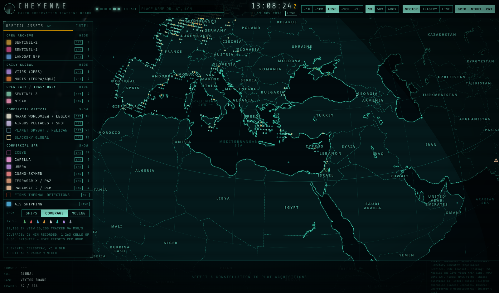

What to expect:

- **Coverage is coastal and uneven.** All four feeds rely on shore receivers, which hear ships out
  to roughly 15 to 40 nautical miles. Northern Europe, the Mediterranean's northern shore and North
  America are well covered, and Finland and Norway best of all thanks to their official feeds. The
  Black Sea, Red Sea, Persian Gulf and Arabian Sea have little or none, and the open ocean has
  none. Outside the Nordics, Open Waters mostly relays what aisstream already provides.
- **Positions and identities are self-reported.** GPS jamming and spoofing are common in conflict
  areas, so ships can report false positions. Warships rarely broadcast AIS, and some ships switch
  it off or broadcast a false identity. A ship missing from the map proves nothing.
- **No history.** The board only knows what it has heard since it was switched on.
- **Terms.** None of the feeds offers an uptime guarantee, and aisstream and Pelyr do not allow
  browsers to connect directly, which is why the server merges the data. Open Waters and Pelyr are
  free for personal, non-commercial use only. Pelyr's terms forbid proxying its service to third
  parties and require its credit wherever the data is shown, so only run the board with your Pelyr
  key for yourself, not as a shared server. Fintraffic's data is CC BY 4.0 and Norway's is NLOD 2.0;
  the panel shows the credits each requires.

## Intel: Telegram monitor

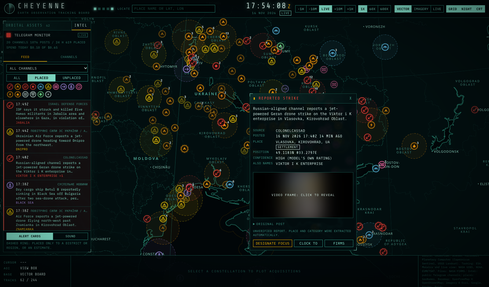

The `INTEL` tab in the left panel follows a list of public Telegram channels. While it is
switched on, the server reads each channel (busy channels every minute, quiet ones every 3 to 10
minutes), keeps the last 24 hours of posts, and places each post on the globe where it can be
located. A new located report raises an alert card, a pulsing ring on the globe and, optionally, a
tone.

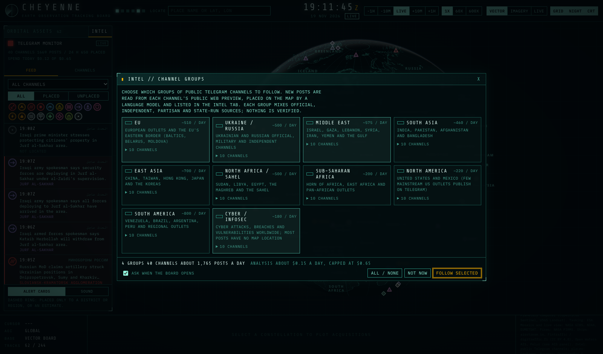

**Channel groups.** When the board opens it asks which groups of channels to follow, with the
expected number of posts and cost per day. Untick `ASK WHEN THE BOARD OPENS` to stop the prompt;
`CHOOSE CHANNEL GROUPS` in the Channels view brings it back. Each group has ten channels, every one
checked to exist and to be posting in November 2026:

| Group | Coverage |
| --- | --- |
| EU | European outlets and the EU's eastern border (Baltics, Belarus, Moldova) |
| Ukraine / Russia | Ukrainian and Russian official, military and independent channels |
| Middle East | Israel, Gaza, Lebanon, Syria, Iran, Yemen and the Gulf |
| South Asia | India, Pakistan, Afghanistan and Bangladesh |
| East Asia | China, Taiwan, Hong Kong, Japan and the Koreas (mostly Chinese-language international outlets) |
| North Africa / Sahel | Sudan, Libya, Egypt, the Maghreb and the Sahel |
| Sub-Saharan Africa | Horn of Africa, East Africa and pan-African outlets |
| North America | United States and Mexico |
| South America | Venezuela, Brazil, Argentina, Peru and regional outlets |
| Cyber / infosec | Attacks, breaches and vulnerabilities worldwide; cyber attacks are placed at the victim |

Every group deliberately mixes official, independent, partisan and state-run sources, including
armed groups' own channels (for example the Russian Ministry of Defence, the IDF, Sudan's Rapid
Support Forces and Russia's Africa Corps). Few mainstream Western outlets publish on Telegram, so the
North America group leans on aggregators and partisan outlets, and the East Asia and South Asia
groups on international broadcasters. The full lists are in `CHANNEL_GROUPS` in `intel.py`. Channels
you add yourself are never changed by the group choice.

- **Feed.** Newest first. Filter by channel or group, placed or unplaced, and category (the row
  of icons). Click a row to fly to the report.
- **A report.** Shows an English summary, the source post, where it was placed and how precisely.
  `DESIGNATE FOCUS` searches imagery of that place with the selected fleet, `FIRMS` checks for
  thermal detections nearby, and `CLOCK TO` moves the board clock to the time of the post.
  `SHARE CARD` makes an image of the report on the map (see [Share cards](#share-cards)).
- **Channels.** Add a channel by `@username` or `t.me` link, pause it with its lamp, or remove
  it.

**Reports are unverified.** The map shows where a post says something happened, as read by a
language model. It is not a confirmed event location. A dashed ring means the report could only
be placed to a district or region, or that the place was not in the gazetteer and the position is
the model's estimate.

How a post is placed:

1. Coordinates written in the post are used as they are.
2. Otherwise the model names the place where the event happened, the kind of event, and a
   one-line English summary.
3. The place name is looked up in an offline GeoNames gazetteer. The model's own rough
   coordinates are only used to choose between places that share a name.

Cost, limits and privacy:

- **Cost.** Analysis costs about $0.09 per 1,000 posts. A typical group produces 200 to 800 posts a
  day; all ten together about 4,700, or roughly $0.40 a day. Extraction stops for the day at the
  daily budget (default $0.65; change it in the Channels view or with `--intel-budget`). The tab
  shows the estimated spend.
- **Only while watched.** Nothing is fetched or spent unless a browser has the monitor switched
  on. Three minutes after the last browser closes, the server stops; it catches up on reopening.
- **Public channels only.** The reader uses Telegram's public web preview
  (`t.me/s/<channel>`), which is not an official API. Private channels and channels with the
  preview turned off cannot be followed, and the reader will need fixing if Telegram changes the
  page.
- **What leaves your machine.** Telegram sees your IP address requesting each channel page; no
  account is involved. Post text and channel names are sent to Anthropic for analysis. Thumbnails
  load from Telegram's servers when you open a report, and stay blurred until clicked.
- **Storage.** Your channel list and seven days of posts are kept in `data/intel.db`. The
  gazetteer (every village in 35 countries of conflict or crisis, towns elsewhere; about 150 MB)
  is built once into `.cache/gazetteer`.

## Data sources

| Data | Source |
| --- | --- |
| Orbital elements | CelesTrak GP data, cached on disk for 3 hours |
| Acquired scenes, tiles, downloads, time-lapse frames | Microsoft Planetary Computer (Sentinel-2 L2A, Sentinel-1 GRD, Landsat C2 L2) |
| NISAR | Alaska Satellite Facility DAAC search API (L2 GCOV); browse images (board and time-lapse) free, products need a NASA Earthdata login |
| Free very-high-resolution releases | Vantor Open Data Program and Maxar Open Data Program (AWS Open Data), Planet Crisis Response (Source Cooperative); CC BY-NC 4.0 |
| Tasking plans | ESA Sentinel acquisition plan KML files |
| Daily global mosaics | NASA GIBS (MODIS, VIIRS) |
| Fire detections | NASA FIRMS near-real-time files (VIIRS on NOAA-20/21, MODIS on Terra/Aqua), cached for 20 minutes |
| Live view | GOES-East/West GeoColor via NASA GIBS; Meteosat and geostationary-ring mosaics via EUMETSAT EUMETView |
| Vector basemap | OpenFreeMap (OpenMapTiles schema, OpenStreetMap data) |
| Imagery basemap | Esri World Imagery |
| Place search | OpenStreetMap Nominatim |
| Ship positions | aisstream.io (free key); Fintraffic Digitraffic (CC BY 4.0, no key); Open Waters AIS, including BarentsWatch and the Norwegian Coastal Administration (NLOD 2.0) and AISHub (no key); Pelyr (free key, Pelyr Data Licence 2.0) |
| Intel posts | Public Telegram channel previews (`t.me/s/<channel>`) |
| Intel place names | GeoNames (CC BY 4.0): every place in 35 countries of conflict or crisis, towns over 500 people elsewhere |
| Intel place extraction | Anthropic API, `claude-haiku-5-5` (optional; needs a login or API key) |

No accounts or API keys are needed for any of these except Intel place extraction, some of the ship
feeds, and full-resolution NISAR products.

## Limitations

- **Predicted passes** for commercial satellites show when a satellite could image a place, not
  whether it will.
- **Live view.** `GEOCOLOUR` has colour imagery over the Americas, Atlantic, Europe and Africa;
  Asia and the western Pacific show infrared. The whole-globe mosaics update every 3 hours.
- **The 7-day FIRMS window** downloads about 60 MB on first use and shows the 150,000 strongest
  detections in view; zoom in to see them all.
- **Downloads are large.** A Sentinel-1 polarisation is roughly 600 MB to 1 GB, and a single
  Vantor or Planet image up to 1.5 GB.
- **Free releases cover disasters only.** Vantor and Planet release imagery of selected natural
  disasters and humanitarian crises, not of armed conflicts, and only for the area and dates they
  choose.
- **Time-lapses** take one frame per date from the scan's results, up to 60 frames, and are encoded
  in the browser; a 720-pixel GIF of 20 to 30 frames is about 10 MB.
- **Share cards** of Intel reports repeat unverified claims from public channels. The card says so,
  but check a report before sharing it. When the report is off screen, or `MAP` is not
  `AS SHOWN`, the board moves briefly to take the picture and then returns.
- **Local use.** The server has no user accounts or access control. It binds to `127.0.0.1` by
  default; do not expose it to the internet.

## Project layout

```
server.py              Local server: static files plus /api (TLE cache, plan parser, FIRMS cache, download proxy)
intel.py               Intel: Telegram reader, post database, gazetteer, place extraction
ais.py                 AIS: the four ship feeds, merged ship state, tracks and coverage counts
opendata.py            Index of the Vantor, Maxar and Planet free-release catalogues
run.sh                 Starts the server, using .venv when present
requirements.txt       Optional packages for the AIS and Intel features
web/catalog.json       Fleets: name patterns, sensor geometry, archive collection, colours
web/js/                Front end as plain ES modules (no bundler)
  main.js                boot and wiring
  globe.js               map, board layers, imagery layers      basemap.js   vector style
  tracker.js             SGP4 propagation, tracks, pass prediction
  archive.js             scene search, plans, access prediction  viz.js       rendering presets
  mission.js             right-hand panel and scan controller    ui.js        top bar, roster, pointer
  board.js               per-frame plotting                      timeline.js  bottom timeline
  firms.js               fire-detection overlay                  live.js      geostationary live view
  intel.js               Intel tab, report markers, cards, alerts and the channel-group prompt
  ais.js                 ship layer, ship card and coverage map
  cog.js                 in-browser reader for cloud-optimised GeoTIFFs and geographic images
  timelapse.js           time-lapse GIF builder
  frames.js              draws any scene over an exact area (time-lapse and share cards)
  cards.js               share cards: board capture, card drawing, before / after picks, dialog
web/vendor/            MapLibre GL JS 5, satellite.js 5, gifenc, fonts and their licences (no CDN at runtime)
docs/screenshots/      Images used in this README
```

Created at runtime and ignored by git:

```
.cache/                Downloaded elements, plans, fire files, release indexes and the gazetteer (safe to delete)
data/                  Intel channel list and stored posts; AIS coverage counts
.venv/                 Optional Python environment for the AIS and Intel features
```

Extending it:

- **Add an imagery basemap.** Add an entry to `IMAGERY` in `web/js/basemap.js` for any Web
  Mercator tile source you are licensed to use. A source picker appears once there are two.
- **Add a fleet.** Add an entry to `web/catalog.json`; `match` is a list of regular expressions
  tested against CelesTrak object names.
- **Change the channel groups.** Edit `CHANNEL_GROUPS` in `intel.py`. Choosing a group in the
  start-up prompt adds any of its channels that are missing.
- **Extend the Intel gazetteer to another region.** Add its country codes to `GAZ_COUNTRIES` in
  `intel.py`, raise `GAZ_VERSION`, and restart; the gazetteer rebuilds on next use.

## Credits and licences

Cheyenne bundles these third-party components; their licence texts are in
[`web/vendor/licenses/`](web/vendor/licenses/):

| Component | Licence |
| --- | --- |
| [MapLibre GL JS](https://github.com/maplibre/maplibre-gl-js) 5.24.1 | BSD 3-Clause |
| [satellite.js](https://github.com/shashwatak/satellite-js) 5.0.0 | MIT |
| [gifenc](https://github.com/mattdesl/gifenc) 1.0.3 | MIT |
| IBM Plex Mono | SIL Open Font License 1.1 |
| Share Tech Mono | SIL Open Font License 1.1 |

Data is provided by CelesTrak, ESA and the Copernicus programme, USGS, the Microsoft Planetary
Computer, NASA (GIBS and FIRMS), NOAA, EUMETSAT, OpenFreeMap and OpenStreetMap contributors,
Esri, GeoNames, aisstream.io, Fintraffic, Open Waters, BarentsWatch and the Norwegian Coastal
Administration (Kystverket), Pelyr, NASA/JPL and ISRO through the Alaska Satellite Facility, Vantor
(formerly Maxar), and Planet Labs PBC. Each provider's own terms apply to its data; the board
shows the credits each AIS feed requires while that feed is in use.

Cheyenne is not affiliated with or endorsed by any of these providers, or by Telegram or Anthropic.
